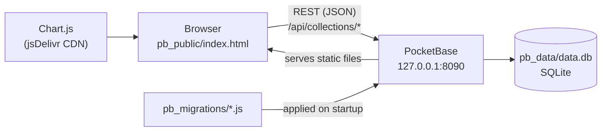

# Architecture

Budget Tracker is a static web page that talks to [PocketBase](https://pocketbase.io), a single-binary backend with an embedded SQLite database. PocketBase also serves the page, so you run one process and open one URL.

## Components

| Path | Role |
|---|---|
| `pb_public/index.html` | Page markup only |
| `pb_public/css/app.css` | Styles, including dark mode |
| `pb_public/js/app.js` | UI: rendering tables and charts, event handlers, loading data |
| `pb_public/js/lib.js` | Pure logic with no DOM or network code: month math, totals, budgets, savings, recurring, CSV, category removal. Fully unit-tested |
| `pb_public/js/api.js` | Data backends with the same interface: PocketBase REST, or in-memory for demo mode |
| `pb_public/js/demo-data.js` | Deterministic fake household for demo mode |
| `pb_public/config.js` | Local settings (starting users, PocketBase URL). Gitignored; copy it from `config.example.js` |
| `pb_migrations/` | Creates the collections and seeds starter categories on an empty database |
| `test/` | `node --test` suites. They don't need a browser or PocketBase |

There's no build step and no npm dependencies. The browser loads the JS files directly as ES modules. Node is only needed to run the tests.

## Data flow

1. **Load:** `app.js` fetches every record from all six collections (paged, 500 per request), then filters to the selected user in the browser.
2. **Edit:** each add, edit or delete is a single REST call. On success, the in-memory copy is updated and the page re-renders. On failure, a toast appears and the copy is left alone.
3. **Derive:** everything shown (totals, budgets, charts, savings) is computed in `lib.js` from the in-memory records. Nothing derived is stored.

## Data model

| Collection | Fields | Notes |
|---|---|---|
| `transactions` | `user`, `date`, `category`, `subcategory`, `description`, `amount`, `recurring` | `date` is `YYYY-MM-DD` text |
| `income` | `user`, `date`, `source`, `amount` | |
| `standard_budgets` | `user`, `category`, `amount` | One per user and category |
| `monthly_budgets` | `user`, `month`, `category`, `amount` | `month` is `YYYY-MM`. Overrides the standard budget for that month |
| `category_data` | `name`, `subcategories` (JSON array) | **Shared by all users** |
| `people` | `key`, `label`, `color` | `key` is unique and never changes. Filled from `config.js` on first load |

`user` is a plain text id matching a person's `key`, so renaming a person only changes their `label`. Removing a person deletes every record they own. Categories are referenced by name, not by record id. That's why renaming a category isn't supported yet and why removing one is handled for every user.

## Design decisions

- **Dates are strings, and month math uses local time.** Converting to UTC (`toISOString()`) shifts months near month boundaries depending on time zone. `lib.js` builds every `YYYY-MM` from local date parts, and `test/timezones.test.js` checks this in 7 time zones.
- **Localhost only, no login.** The collections' API rules are public. That keeps the app simple for one household on one machine, but it means the server must not be reachable from a network. See [Operations → Security](operations.md#security).
- **Demo mode never touches PocketBase.** `?demo` swaps in the in-memory backend, so nothing a visitor does can reach real data.
- **Migrations don't destroy data.** The starter-categories migration only runs on an empty `category_data` collection, and reverting it is a no-op.
